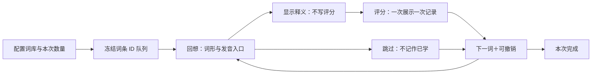

# 单词页面完整测试与移动体验优化报告

日期：2026-10-15。对象：[刷题记线上站点](https://www.lql170.cn/) `20261015c` 版与当前本地源码。  
证据：13 张本轮真实浏览器截图、线上错误堆栈与命中／几何数据、30 个隔离功能场景、现有前端校验日志。  
范围：列表、搜索、分类、熟悉度筛选、遮罩、卡片、沉浸阅读、测验、键盘操作、评分与调度、词库去重、失败恢复、小屏空间。未修改业务源码或部署。

## 一、结论与建议决策

**单词页的问题已经超出“控件太多、间距太大”。目前同时存在学习流程不顺、状态错误和小屏空间分配失衡。建议先修确定的功能缺陷，再把连续学习改为独立任务界面。**

最关键的三个判断：

1. **把一切带进学习场景，导致空间始终不够。** 搜索、全库统计、模式说明、分类、筛选和全站底栏同时出现。390×844 下第一条单词从约 y=447 才开始；320×568 下卡片评分按钮从 y≈711 才出现。
2. **“揭示答案”和“自评熟悉度”被绑成同一步。** 用户不能只看看释义，必须先选认识／模糊／忘记；页面中大面积空白又没有可点击提示。这会迫使部分用户用评分当作翻面按钮。
3. **状态与记录存在会破坏信任的错误。** “未标记”筛选在线抛异常；遮罩写着点击显示却点不开；测验搜索零结果后仍显示旧题；过滤后的卡片评分会换到下一词并直接揭示；老词选忘记可能安排到 30 天后。

**推荐方向：保留一个词库入口，将“查词”和“本次学习”分成两种任务。** 查词保持搜索与筛选；开始背诵／测验后进入专注界面，冻结本次队列，收起全站导航和筛选，把退出、进度与主要操作保留下来。无需把按钮和文字继续缩小。

## 二、本轮测试结果与边界

### 2.1 结果概览

| 测试层 | 结果 | 可据此得出的结论 |
|---|---|---|
| 当前既有前端套件 `run_all.mjs` | 7 步全通过；jsdom 211 项通过；交互冒烟 48 次无异常 | 现有回归要求满足，但覆盖不到下面所有真实任务 |
| 本轮隔离专项测试 | 30 场景：14 PASS、16 ISSUE、0 测试框架错误 | 16 个问题场景归并为 13 类功能／交互问题；不是 16 个独立漏洞 |
| 线上浏览器测试 | 已确认遮罩失效、筛选异常、浮层叠加、搜索／测验不一致，以及小屏空间问题 | 不只是静态代码推测 |
| 响应式截图 | 320×568、390×640、390×844、768×1024、1440×1000 | 覆盖窄屏、短屏、平板宽度及桌面；不能替代实体手机兼容测试 |

专项脚本执行的是当前 `english.js` 的实际函数，仅在测试副本中暴露私有状态。评分、重复点击、到期记录等使用隔离数据；没有向用户真实账号写入学习进度。线上没有提交测验答案或评分。截图采集约为北京时间 18:31–18:54，线上静态资源标记均为 `20261015c`；未据版本字符串宣称线上脚本字节与本地完全一致。

手机截图是 Chromium 的窄视口响应式页面，**不是实体手机拍摄**。截图接口的部分返回图像尺寸与 CSS 视口不同，原始尺寸与时间见 `screenshots.json`。所有本轮截图均为真实页面，未用原型图替代。

### 2.2 已有改进，应当保留

- 词库统计改为默认折叠，分类内重复分类标签减少。
- 手机沉浸阅读的间距规则已限制到正确断点，上一轮“桌面规则回盖手机”的问题不再沿用为本轮结论。
- 搜索能跨分类找到词；常规测验可生成四个不同选项；答题反馈与完成面板在隔离测试中工作。
- 初次列表只渲染 30 行；失败分片不会永久缓存为空，后续请求能够恢复。
- 复习队列能按快照给正确的词写入标记；卡片位置越界有回退。
- 测验答对不直接升级熟悉度是现有设计，**不把这一点当作程序错误**。但可另行记录测验作答历史，避免“今日已学”只反映评分动作。

## 三、小屏空间到底花在哪里

### 3.1 实测

390×844 列表页，首条词形 `abandon` 的顶部为 **446.75px**。其中：

| 区域 | 实测或当前状态 |
|---|---|
| 顶部账号栏 | 高约 48.67px |
| 搜索栏 | 高约 40.67px |
| 已折叠词库概览卡 | 仍高约 84.34px |
| 模式／分类／高级筛选卡 | 高约 213.07px |
| 全站底部导航 | 高约 61.67px |
| 首条词形之前 | 约 447px，约占 844px 视口的 53% |

忽略输入法，首条词形到固定底栏顶部仅剩约 `844−61.67−446.75≈335.6px`，不足整个视口的 40%。这里是几何估算，不是用户注视时间或真实学习效率。

320×568 卡片页，卡片顶部约 448.67px；卡片高 250px；评分行顶部约 710.67px，已超出首屏。390×640 下评分行顶部约 708.75px，仍在视口外。评分按钮本身高约 **37.73px**、字号 12.75px；空白卡片却占据 250px。

**这不是横向挤不下：320px 场景没有检测到页面横向溢出。核心是垂直空间被管理界面、固定最小高度和空白占据。**

### 3.2 对症建议

| 当前习惯 | 建议变化 | 原因 |
|---|---|---|
| 先压字号和间距 | 先减少当前任务不需要的控件 | 小字不会减少任务复杂度，还会降低可读性 |
| 学习页保留全站底栏 | 连续学习时用明确退出入口替代 | 释放底部空间，减少误切页 |
| 模式、分类、筛选始终常驻 | 在任务开始前配置，任务中冻结 | 避免状态冲突，减少每词重复扫视 |
| 用 250px 卡片＋虚线空白制造“卡片感” | 未揭示态只保留词形、提示和显示释义按钮 | 留白用于聚焦，不伪装可点击区域 |
| 先评分才揭示 | 回想→揭示→评分→下一词 | 评分只表达学习结果 |
| 长词库一口气开 2345 词 | 默认短任务，如 10／20 词，可自选 | 让用户有结束点、可恢复位置与完成反馈 |

## 四、13 类问题：复现、影响与改动建议

P1 为应在下一轮可用性发布前处理；P2 为随后性能、容错与一致性改进。它们不是安全漏洞分级。

### F01 · P1：“未标记”筛选直接报错

**线上步骤：** 单词→高级筛选→未标记。控制台产生 `TypeError: Cannot read properties of undefined (reading 'n')`，堆栈指向 `filterHint`，线上 `english.js?v=20261015c:672`。

`only='new'` 时仍执行 `LEVELS[+only].n`，`+only` 为 NaN。`emptyHtml` 还有同样访问，因此非空与空结果两个场景都失败。对应测试 02、03。

**建议：** 将未标记作为明确枚举处理，集中定义所有筛选状态的标签；不要在两个渲染函数内分别隐式转数字。错误后保持可操作的清除筛选入口。

**验收：** 未标记有词、无词、搜索叠加、切模式四种情况下均不抛异常。

### F02 · P1：用户无法“只看释义”，评分变成翻面按钮

**实机：** 卡片首次进入只看到英文、空白虚线框、认识／模糊／忘记。没有独立揭示、跳过或正常的下一词。沉浸页也要先评分，才出现释义、词源、例句与导航。对应测试 04；`cardHtml:552`、`readerHtml:412`、`eng-mk:1006`。

这是现有产品约束，测试也明确断言“卡片只显示三个评分按钮”；**并非仅仅漏写了某个点击处理器**。但它与“我想先看答案，再判断是否记得”相冲突。词典式精读被迫产生复习事件，同样不合理。

**建议：** 增加不写进度的“显示释义”；揭示后再显示评分。跳过不记为学会；查看详细资料不记为复习。沉浸精读打开时可直接显示释义，将记忆挑战留给背诵任务。

**验收：** 连看十个词的释义，不评分时不增加 n／log／今日评分次数；每次评分都有明确的已揭示上下文。

### F03 · P1：遮罩显示“点击显示”，实际点不开

**线上步骤：** 列表→高级筛选→遮中文→完成→点击释义遮罩。点击后仍为 `.eng-cn.mask`。命中元素是没有 `data-act` 的 SPAN，`listRowHtml:510` 输出的词形 DIV 也没有单独揭示动作。对应测试 05。

页面文案与交互承诺不一致。当前“列表完全无交互”的设计，与遮罩的点击提示互相冲突。

**建议：** 让遮住的字段使用真实按钮，点击仅揭示本字段，不进入详情、不写评分。用一个固定的卡片翻面／详情动作入口，避免整行多重含义。若坚持列表只读，应移除逐项点击提示，并明确“统一关闭遮罩后查看”。

**验收：** 遮中文、遮英文分别可用触控与键盘揭示；点击发音、释义、详情三个区域不会相互误触。

### F04 · P1：从筛选进入沉浸，筛选浮层继续挡在上面

**线上：** 卡片→高级筛选→沉浸式背单词。沉浸页已经打开，但高级筛选仍显示在其上方，必须再点完成才能学习。截图 04 直接显示这个状态。对应测试 06。

`eng-immersive:969` 调用 `openReader` 前没有关闭高级筛选；前者页面层级 40，筛选层 60。

**建议：** 沉浸／开始学习是导航动作，应放到主界面，不能藏在“高级筛选”中；转场应关闭前一个面板、恢复正确焦点并锁定背景。不要只提高沉浸层 z-index 掩盖状态错误。

筛选面板还应补齐对话框语义、进入／退出焦点与背景隔离，参考 [W3C 模态对话框模式](https://www.w3.org/WAI/ARIA/apg/patterns/dialog-modal/)。

### F05 · P1：按状态筛选后评分，当前词被替换并直接揭示

**隔离步骤：** 两个“忘记”词 alpha、beta；筛选忘记并进入卡片；给 alpha 标认识。alpha 从筛选结果消失，重新计算的索引 0 变成 beta，但 `cardRevealed=true` 继续保留，于是 beta 的答案被直接展示。对应测试 07。

**建议：** 开始任务时冻结词 ID 队列；`currentWordId`、揭示状态和本次展示 ID 绑定。评分只更新这个 ID，随后按任务规则推进。筛选结果可以在退出任务后更新，不能在评分中途替换当前对象。

**验收：** 忘记、模糊、未标记三种筛选，首词／中间词／末词评分均不跳错对象、不提前泄露下一词答案。

### F06 · P1：重复点击评分会累计为多次复习

**隔离：** 连续调用同一词“认识”两次，`n=2`、log 两条；当前间隔由首次约 30 天进到第二次约 90 天。实际界面评分后仍保留按钮，修改选择也没有与新增复习区分。对应测试 08；`pset:70`。

**建议：** 每次展示生成一个作答事件标识。一次展示只提交一次；修改当前评分应替换该事件并重算结果，不追加复习次数。评分后立即进入下一词，保留一次撤销；防抖只能辅助，不能替代事件幂等。

**验收：** 双击、反复改分、返回上一词、撤销重评，都不会凭空增加多次复习或拉长间隔。

### F07 · P1：越熟的词忘记后，反而可能越晚再见

**隔离：** 词原有 `n=12`、状态认识，改为忘记后变 `n=13`，下次时间为约 **30 天后**。原因是 `nextDue(s,n):66` 直接拿累计总点击次数选择“忘记”间隔表的末档。对应测试 09。

这与代码中“答错安排 1 天后重考”的描述不一致，也无法体现本次遗忘。

**建议：** 至少把累计复习次数与当前阶段分开；遗忘时重置／降低阶段，安排较近重学。可先使用简单且可解释的规则，不必立即引入复杂算法。具体分钟／天数是产品调度参数，应验证后决定；本报告不声称某个算法能保证记忆效果。

**验收：** 老词与新词本次选忘记，都进入预定的近期重学区间；单纯累计点击更多不能推迟遗忘词的重学。

### F08 · P1：搜索结果与正在答的测验不属于同一个范围

**线上：** 测验中输入 `zzzznomatchaudit`，计数变“共 0 词”，下方仍是原有 **1／2345** 及四个选项。对应测试 10、11，截图 08。

`updateList:733` 只更换渲染词表，`quizList` 没有重建／退出；`quizHtml:615` 继续使用旧快照。

**建议：** 优先采用冻结测验队列并隐藏搜索／分类；需要查词时明确退出或暂存本轮。若允许改变范围，必须明确“重开测验”，同步清理题号、答案、错题数和干扰项。不能让当前控件看似生效、实际题源不变。

**验收：** 零结果时没有旧题；用户知道本轮题源是什么；切换分类、标签、熟悉度也遵守同一规则。

### F09 · P2：音频失败后界面仍当作已发起成功，没有当次补救

**故障注入：** `Audio.play()` reject，`speak()` 返回 true；当次没有触发 TTS 兜底。连续三次失败才永久切换到 TTS，当前会话没有音频恢复机制。对应测试 14；`playAudio:298`、`speak:371`。

**建议：** 显式区分加载／播放／失败；失败时允许点击重试或使用系统发音。能否直接异步切 TTS 要在 iOS 手势限制下验证，不应承诺任何平台都自动兜底。恢复网络后允许重新尝试音频，不把暂时失败永久记成该会话不可用。

**验收：** 音频接口失败、无系统语音、恢复网络三种情况都有明确反馈；听音题失败时不能只让用户面对无声的题目。

### F10 · P2：全库按词条行累加，学习身份却按词形合并

**真实本地数据：** manifest 总词数 6572，三个分类原始条目 6791，按当前学习键 `词形小写+trim` 去重后为 6572，重复行 **219**。例如 abortion 在两个分类出现；只让这个词到期，概要待复习=1，`dueCountSync()`=2。对应测试 15、16。

**建议：** 明确“词形、词义、来源、学习单位”四者关系。一个 canonical 词条可保留多个来源／词义；全库学习按实际学习单位去重。若不同词义需要分开学，就用明确的词义 ID 和对应统计，不应一边合并评分、一边重复排队。

**验收：** 页面总数、搜索、复习队列、完成统计使用一致口径；合并来源不能丢弃不同释义与例句。

### F11 · P2：“展示全部”一次加入 2315 行

首批 30 行正常；点击展示全部后，六级分类一次从 30 行变成 2345 行。对应测试 17 通过、18 暴露风险；`showAllList:538`。

`content-visibility` 已存在，可降低部分屏外绘制，但不等于没有 DOM 创建与文本解析成本。jsdom 测试耗时不能拿来当真实手机帧率，本报告未量测设备性能。

**建议：** 每批增量加载 30–50 行，保留显式“更多”；用户搜索通常无需把全库装进 DOM。若以后做虚拟列表，必须先定义返回位置与阅读器辅助技术的行为，不必为几千条词立即上复杂组件。

**验收：** 单次新增不超过约定批量；连续加载及返回列表保留位置；另用低端实体手机测长任务和交互延迟。

### F12 · P1：搜索框输入数字会触发测验选答案

**隔离步骤：** 进入测验，让搜索框获得焦点，派发按键 `1`。`quizPicked` 从 -1 变为 0；若所选项错误，还会给对应词写入忘记。对应测试 27；`keydown:1040`。

全局监听器只检查测验模式，没有排除 input、textarea、select、contenteditable，也没有完整检查当前活动页面与浮层。

**建议：** 快捷键仅在当前可见测验任务中启用；输入、文本编辑、输入法组合阶段和模态浮层优先。隐藏／退出任务应解绑或关闭该路由。

**验收：** 搜索框输入 1–4／空格／Enter 不答题；中文输入法组合输入不触发；离开单词页也不能操作残留测验。

### F13 · P2：下载失败显示成“没有词条”

**注入：** 分片请求失败时 `loadDept` 返回空数组，页面显示没有词条，没有区分网络失败。恢复后重新加载可以成功，这项重试能力本轮已经通过。对应测试 29、30。

**建议：** 区分加载中、网络失败、真空词库、筛选零结果四种状态。失败时给重试，保留当前分类与查询；成功空结果才能说“没有词条”。

## 五、让小手机获得更大体验：具体产品方案

### 5.1 顶层只保留两种任务

**词库／查词页：** 一个搜索框、一行当前词库与筛选摘要、结果列表、开始学习按钮。总词量与今日数据用紧凑摘要，不再独占一张空卡；模式说明放在首次帮助中。搜索时展示准确的范围，跨库搜索不能继续只标“六级单词”。

**本次学习页：** 明确入口后进入独立全屏任务。顶部“退出｜本次词库与范围｜进度”；中央内容；底部主操作。学习时隐藏全站底部导航、搜索、概览卡、三模式介绍与高级筛选。任务配置可从顶部名称打开，改变题源则结束／重开，不在答题过程中静默改变。

查词页可以提供“直接查看详情”，不要求先进入背诵和评分。背诵与测验作为学习任务的两种类型选择，深度资料是词条详情，不再被命名成“高级筛选”里的另一种模式。

### 5.2 明确一次学习的状态机

“显示释义”不改变熟悉度；点击发音不改变熟悉度；展开资料不改变熟悉度。评分变更与撤销应保持记录和调度一致。退出保留本次队列及位置，回来继续，不重新洗牌。

评分按钮沿用一套固定顺序、文字和位置即可；是否改为“忘记／模糊／认识”需要作为一次明确的交互变更，避免老用户依赖肌肉记忆时误触。不要根据答案长度或熟悉度临时换位置。

### 5.3 给小屏一份空间预算

以下是**改造目标，不是已实现测量值**：

| 区域 | 目标高度／策略 |
|---|---|
| 退出、任务名、辅助入口 | 约 48–56px，一行 |
| 轻量进度 | 约 20–28px，不另套大卡 |
| 当前词及学习内容 | 弹性使用剩余空间，内容可滚动 |
| 显示答案或三评分操作 | 约 64–88px，包含必要边距；安全区额外计算 |
| 可撤销提示 | 按需约 24px；不要持续占据大块面板 |
| 全站底栏、统计、模式说明 | 连续学习时不占位 |

844px 高的视口，按 56＋28＋88＋24 的预算，学习内容约有 648px，约占 77%；568px 高的视口约剩 372px，约占 65%。相比当前约半屏才开始出词，改善来自减少任务外的管理界面，而不是压缩正文。

小屏验收应关注**当前主要动作是否始终可见**，不强求长例句或所有文献都塞进首屏。可以滚动资料，不能每学一个词都反复寻找评分按钮。

### 5.4 内容分层

| 层 | 默认展示 | 放在哪里 |
|---|---|---|
| 必需 | 词形、音标／发音、核心释义 | 单词主体 |
| 帮助理解 | 一个有代表性的例句和可展开译文 | 释义之后 |
| 深度学习 | 其他词义、词源、更多例句、文献与来源 | 独立展开区或详情面板 |
| 任务管理 | 换库、标签、熟悉度、模式 | 任务开始前配置 |
| 统计 | 今日完成、待复习、连续天数 | 词库首页或完成页 |

不要展示无法使用的空白框；没有词源／例句时自然省略该节。错误、缺失和网络状态使用短而可理解的文案，避免向普通用户解释构建脚本。

### 5.5 手机适配与输入法

- 主要按钮建议提供约 44–48px 的有效触控高度，常用正文约 16–18px。当前 37.73px 的评分高度不是“必然违反 AA”，但不宜作为高频拇指操作的目标。WCAG 2.2 AA 的目标尺寸规则以 24 CSS px 或相应间距／例外为基础，参见 [W3C 目标尺寸说明](https://www.w3.org/WAI/WCAG22/Understanding/target-size-minimum.html)。
- 主体用可收缩的 flex 布局，保证内容区 `min-height:0`；学习区只有一个主要滚动容器，避免外壳、卡片、阅读层三层一起滚。
- 搜索键盘弹出时，统计与辅助说明收起，结果在键盘上方；明确提交／清除与收起键盘，不随输入去操作隐藏测验。
- 使用实际可视区域适配键盘与浏览器工具栏，不能只依据 100vh。`VisualViewport` 可以反映屏幕键盘使可视区域缩小的情况，参见 [MDN VisualViewport 文档](https://developer.mozilla.org/en-US/docs/Web/API/VisualViewport)。这仍需 iOS／Android 实机验证。
- 保留安全区和文字放大，长医学词可断行；不要通过禁用缩放来解决布局冲突。

## 六、实施次序与可验收任务

| 阶段 | 改动 | 必须过的验收 |
|---|---|---|
| 第一批：恢复基本可信度 | F01、F03、F04、F08、F12 | 筛选不崩；遮罩能开；只有一层任务浮层；搜索不串题；输入不答题 |
| 第二批：评分与队列正确 | F02、F05、F06、F07、F10 | 揭示不记分；评分幂等；误触可撤销；遗忘词近期重学；队列 ID 稳定且口径一致 |
| 第三批：小屏任务界面 | 独立学习壳、底部操作、短任务、内容分层 | 320×568 主操作可见；390×640 不反复找按钮；退出恢复位置 |
| 第四批：容错与性能 | F09、F11、F13 | 音频失败可解释；列表增量；下载失败与真空结果区分 |

这四批是拆分建议，不是必须等到第四批才可发布。评分和调度修改要针对旧数据迁移及跨端合并增加回归，不能为了新界面清空历史。

### 完整改造验收矩阵

| 场景 | 应验证内容 |
|---|---|
| 新用户／零记录 | 有明确开始操作，不被大批 0 与空白卡片包围 |
| 查英文／查中文／零结果 | 范围明确；一键清除；输入法不触发答题 |
| 未标记／忘记／模糊／认识 | 各自为空与非空；与标签／搜索组合 |
| 遮中文／遮英文 | 独立揭示；可键盘操作；不写进度 |
| 回想→揭示→评分 | 记录恰好一次；下一词未提前揭示 |
| 改分／双击／撤销／返回 | 事件和调度一致，不增加虚假复习 |
| 分类内／全库／跨源同词 | 统计、队列和完成数口径一致，词义信息不丢 |
| 测验三题型 | 题源冻结；失败提示；切换／退出／恢复可预期 |
| 断网／慢请求／恢复 | 有可重试状态；不把下载失败说成空词库 |
| 320×568／390×640／390×844 | 高频操作可见，长内容可滚动，字体不被压小 |
| 768／1440 | 单词与释义保持阅读宽度，不仅横向拉伸控件 |
| 实体 iOS Safari／Android Chromium | 键盘、安全区、工具栏收缩、音频权限、文字放大与返回行为 |
| 登录后双端 | 队列、评分修正、撤销与同步的关系明确；不靠整包覆盖 |

## 七、测试清单与证据索引

### 7.1 30 个专项场景

| 测试编号 | 结果 | 场景／关联 |
|---|---|---|
| 01 | PASS | 初始列表正常渲染 |
| 02、03 | ISSUE | 未标记过滤的非空／空态，F01 |
| 04 | ISSUE | 独立揭示缺失，F02 |
| 05 | ISSUE | 遮罩不能揭开，F03 |
| 06 | ISSUE | 进入沉浸仍开筛选，F04 |
| 07 | ISSUE | 过滤后评分换词并提前揭示，F05 |
| 08 | ISSUE | 重复评分增加复习记录，F06 |
| 09 | ISSUE | 老词忘记后延至 30 天，F07 |
| 10、11 | ISSUE | 测验搜索范围与当前题不同，F08 |
| 12 | PASS | 正确选项反馈；答对不自动升级熟悉度 |
| 13 | PASS | 小题池能回退到全库补四选项 |
| 14 | ISSUE | 音频拒绝时未当次反馈／兜底，F09 |
| 15、16 | ISSUE | 全库重复排队与待复习数不一致，F10 |
| 17 | PASS | 初始 30 行 |
| 18 | ISSUE | 一次展示全部增加 2315 行，F11 |
| 19 | PASS | 普通熟悉度空态提供清除入口 |
| 20 | PASS | 跨库词检索 |
| 21 | PASS | 复习队列标记身份正确 |
| 22 | PASS | 常规干扰项按展示值去重 |
| 23 | PASS | 退出阅读返回底层视图 |
| 24 | PASS | 复习完成面板 |
| 25 | PASS | 卡片索引越界回退 |
| 26 | PASS | 测验完成边界 |
| 27 | ISSUE | 搜索框数字键触发答题，F12 |
| 28 | PASS | 卡片模式搜索零结果有恢复入口 |
| 29 | ISSUE | 下载失败伪装词库空，F13 |
| 30 | PASS | 分片失败后恢复重试 |

### 7.2 真实截图

下列路径均在本轮 `单词页专项审计_20261015/`，不混用上一轮图片：

| 文件 | 说明 |
|---|---|
| `01-list-390.jpg` | 新版列表，统计已折叠 |
| `02-card-unrevealed-390.jpg` | 卡片空白与评分先于揭示 |
| `03-card-filter-390.jpg` | 沉浸入口隐藏在高级筛选 |
| `04-immersive-first-390.jpg` | 沉浸已打开，筛选仍挡在上面 |
| `05-immersive-blank-390.jpg` | 关闭筛选后，沉浸主体大面积空白 |
| `06-card-320x568.jpg` | 小屏首屏看不到评分操作 |
| `07-quiz-390.jpg` | 正常手机测验布局 |
| `08-quiz-zero-results-390.jpg` | 共 0 词却显示旧测验 |
| `09-new-filter-error-390.jpg` | 未标记操作报错时的界面；错误需结合日志阅读 |
| `10-list-masked-390.jpg` | 点击显示的遮罩；结果见点击验证 JSON |
| `11-list-masked-768.jpg` | 平板宽度列表 |
| `12-list-masked-1440.jpg` | 桌面宽度列表 |
| `13-card-390x640.jpg` | 短屏卡片与底栏 |

**典型证据：小屏学习区尚未展开，固定导航已占住底部。**

**典型证据：词数已经为零，测验仍继续显示旧题。**

**典型证据：高级筛选覆盖新打开的沉浸页。**

### 7.3 可复核附件

- `audit-tests.mjs`、`functional-tests.json`：30 场景复现。运行 `node 文档/单词页专项审计_20261015/audit-tests.mjs` 更新结果。脚本正常退出表示采集完成，不表示业务测试全通过；有框架错误才非零退出。
- `existing-frontend-suite.log`：本轮既有七步套件输出。其“只允许三评分按钮”“列表行不可点击”的断言需随产品交互调整重写，不能仅增加几个 CSS 检查。
- `online-console-errors.json`：线上 F01 堆栈。
- `masked-click-result.json`：线上遮罩点击后仍有 mask 的证据。
- `card-space-320.json`、`online-metrics-short-phone.json`：位置、按钮尺寸、版本与视口。
- `screenshots.json`：13 张原图的像素尺寸与保存时间。
- `screenshot-gallery.html`：全部真实截图的可点击画廊，便于按场景查看原图。
- `source-sha256.json`：本地源码与英语 manifest 指纹。
- `word-study-proposal.html`：可体验揭示、评分、下一词、跳过、撤销、退出／恢复及 320px 模式的方案稿。数据全部为样例，不连接云端、不是真实站点改造截图；核心交互已通过 jsdom 检查，尚未做浏览器几何验收。

## 八、未验证范围与上线前补测

本报告对上述范围做了完整场景复核，但不宣称穷尽所有设备和用户数据。实体 iPhone／Android、真实软键盘和扬声器听感、蓝牙／静音模式、语音权限、中文输入法、屏幕阅读器、暗色及每套纹理主题、真实登录多端同步仍未实测。音频与网络故障结论来自隔离注入，不等于判定线上词典服务当前不可用。

本轮未进行医学释义逐条正确性审查；单词去重建议也不意味着允许丢弃不同词义。完成交互修改后，应先以少量新老用户试点，记录首次启动完成率、每词操作次数、误评分撤销、退出后恢复成功率；再判断体验是否改善，不能只用“页面更紧凑”验收。
